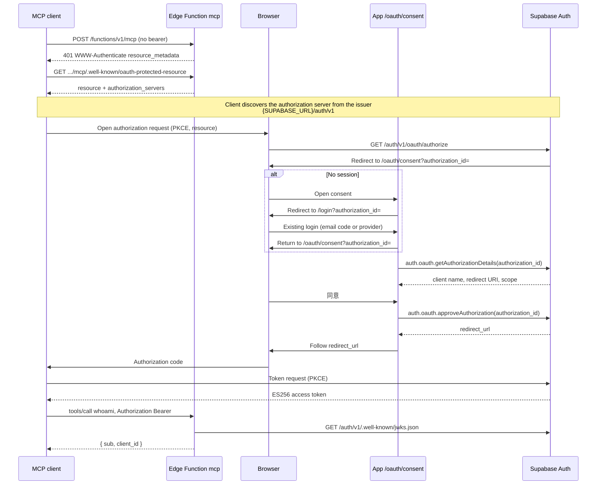

# Spike M0: OAuth consent and a read-only MCP server

Throwaway branch `spike/m0-oauth`. Not deployed. No pull request. The hosted OAuth Server stays off until Yifeng approves a later preview setup. This branch does not call hosted Supabase, does not change Auth settings, and contains no project keys.

The consent route is `/oauth/consent` (`app/oauth/consent.tsx`). The MCP server is the Edge Function `supabase/functions/mcp/`, served at `{SUPABASE_URL}/functions/v1/mcp`.

## End-to-end flow

Supabase Auth is the OAuth 2.1 authorization server. The Edge Function is only the resource server. The app supplies the consent screen.



Deny calls `denyAuthorization` instead of `approveAuthorization` and follows that redirect, which carries `access_denied`.

`getAuthorizationDetails` can also return only `redirect_url` when Supabase already stored consent for those scopes. The screen follows that URL. It does not call `approveAuthorization` on that path. Agree is the only control that calls `approveAuthorization`.

## Consent page

Route: `/oauth/consent?authorization_id=` from `app/oauth/consent.tsx`. It is a public Expo Router screen. Signed-out people are sent to the existing login screen with the same `authorization_id`. After a session exists, the root navigator sends `/login` back to `/oauth/consent?authorization_id=`. Provider sign-in (`signInWithProvider`) sets `redirectTo` to that consent path on the current origin. The id is also kept in `sessionStorage` under `oauth-consent-authorization-id` so a full-page provider return that lands on `/` can be sent back. The consent page clears that key once a session is present.

The screen shows three fields, in Chinese:

- 应用: `client.name`
- 回调地址: `redirect_uri` (text, not a link)
- 请求的权限: `scope` split on spaces

It does not show the email on the authorization payload.

Invalid or expired ids, and any thrown client error, become the fixed line `授权请求无效或已过期`. The raw error and its stack are not rendered.

`approveAuthorization` and `denyAuthorization` are called with `{ skipBrowserRedirect: true }`. The screen then assigns `location` only when the returned URL is `http` or `https`, has no userinfo, and has the same origin and path as the redirect URI that was on screen. Query parameters (`code`, `state`, `error`) may differ. A mismatch stays on the page with `授权没有完成`.

### supabase-js calls

Installed types are `@supabase/supabase-js` / `@supabase/auth-js` 2.118.0. The methods live on `supabase.auth.oauth` (`AuthOAuthServerApi`):

- `supabase.auth.oauth.getAuthorizationDetails(authorizationId)`
- `supabase.auth.oauth.approveAuthorization(authorizationId, { skipBrowserRedirect: true })`
- `supabase.auth.oauth.denyAuthorization(authorizationId, { skipBrowserRedirect: true })`

Wrappers: `loadAuthorization` and `submitAuthorizationDecision` in `src/data/oauth-consent.ts`. The screen does not import the Supabase client. `getAuthorizationDetails` returns either `OAuthAuthorizationDetails` (`authorization_id`, `redirect_uri`, `client`, `scope`, and a `user` object this UI ignores) or `OAuthRedirect` (`redirect_url` only). Narrow with `'authorization_id' in data`, as the type docs describe.

## MCP function

`supabase/functions/mcp/` is Streamable HTTP (protocol `2025-03-26` and `2025-06-18`). One tool, `whoami`. No database access and no writes.

| Request | Result |
| --- | --- |
| `GET` `{resource}/.well-known/oauth-protected-resource` | RFC 9728 document, no bearer required |
| Any other method on the MCP URL without a bearer, or with a token that fails verification | `401` and `WWW-Authenticate: Bearer resource_metadata="<metadata URL>"` |
| `POST` JSON-RPC `tools/call` `whoami` with a verified token | `{ sub, client_id }` |

`resource` is `{origin}/functions/v1/mcp`. `origin` is `new URL(SUPABASE_URL).origin`. The metadata URL is `{resource}/.well-known/oauth-protected-resource`. `authorization_servers` is `["{origin}/auth/v1"]`. The same handler also answers a path that merely contains `/.well-known/oauth-protected-resource`, which is the RFC 9728 insertion form. The gateway in front of Edge Functions may not route the origin-level well-known path to this function. Clients that honor `WWW-Authenticate` do not need that route.

The function reads `SUPABASE_URL` only. It does not read a privileged API key or a JWT secret. `index.ts`, `handler.ts`, and `jwt.ts` do not call `console`. A failed JWKS fetch is a verification failure and returns the same 401. The body is `{ "error": "invalid_token" }` with no token and no error text from the verifier.

`GET` and `DELETE` on the MCP URL, after a valid token, are `405`. This server does not open an SSE listen stream and does not issue `Mcp-Session-Id`. `POST` responses are `application/json` when the client accepts it, otherwise one SSE `message` event.

## Token validation

Verification is local, against the JWKS document at `{origin}/auth/v1/.well-known/jwks.json`.

Accepted tokens:

- Header `alg` is exactly `ES256`. `crit` is rejected. `typ`, when present, must be `JWT`.
- The key is an EC P-256 public JWK (`kty` `EC`, `crv` `P-256`, `x` and `y` only). `alg` on the key, when present, must be `ES256`. `use`, when present, must be `sig`.
- `kid` selects that key. Shared-secret keys (`kty` `oct` or an HMAC `k`) are never imported. There is no HMAC path and no shared-secret fallback.
- Signature is raw R||S, 64 bytes, checked with WebCrypto ECDSA P-256 / SHA-256.
- `iss` equals `{origin}/auth/v1`.
- `aud` is the string `authenticated`, or an array that contains it. This is the Supabase access-token audience from the auth-js `JwtPayload` example. It is not the MCP resource URI.
- `exp` is a finite number of seconds and is still in the future. `nbf`, when present, is not in the future.
- `sub` is a non-empty string without control characters.

Anything else, including an HS256 token, a token signed by a different P-256 key, a wrong issuer, a wrong audience, or an expired token, is 401 with the same `WWW-Authenticate` header.

If the preview project's **current** signing key is still HS256, Auth will mint HS256 access tokens and this function will reject every one of them. ES256 has to be the current signing key before the function is deployed. Do not hand the function the shared secret to paper over that.

### `client_id`

`whoami` returns a new object with exactly two fields:

```json
{ "sub": "<sub claim>", "client_id": "<client_id claim or null>" }
```

`client_id` is null when the claim is missing or null. A non-string `client_id` is a verification failure. The email claim is not copied into the result.

What the current docs and types say, without a live token (this spike did not call hosted Auth):

- The OAuth 2.1 server guide says access tokens are Supabase JWTs that include `user_id`, `role`, and `client_id`.
- `@supabase/auth-js` 2.118.0 `JwtPayload` / `RequiredClaims` requires `iss`, `sub`, `aud`, `exp`, `iat`, `role`, `aal`, and `session_id`. `client_id` is not in that required set. The `getClaims()` example omits it. `sub` is the subject. This spike reads `sub`, not `user_id`.

So `client_id` is documented for OAuth-server access tokens and is not a required claim on every Supabase access token. A first-party session token can pass `whoami` with `client_id: null`.

## `config.toml`

`[auth.oauth_server]` was already present and is unchanged: `enabled = false`, `authorization_url_path = "/oauth/consent"`, `allow_dynamic_registration = false`. This spike does not enable the OAuth server.

The only addition is `[functions.mcp]` with `verify_jwt = false`. The platform JWT check would reject a missing bearer before the function runs, and that gateway response would not include `WWW-Authenticate`. The function performs the ES256 check itself. No secrets are added to the function config.

## Revocation (not implemented)

MP1 requires that after a revoke, the next call fails, and that this is checked by seeing that `session_id` still exists in `auth.sessions`, not by `getUser` alone.

This spike does not do that. A token that still has a valid ES256 signature, issuer, audience, and expiry is accepted until `exp`, including after the session row is gone.

Why `getUser` / `getClaims` is the wrong stand-in:

- `getClaims()` on an asymmetric key verifies locally against the JWKS and does not ask Auth whether the session still exists. That is the same cryptographic check this function already does.
- `getUser()` does call Auth. The project security rule is still that deleting a user or signing out does not invalidate an existing access token, and that a strict check reads `auth.sessions`.
- Neither call is a substitute for the database check MP1 names.

How a later change could use this spike: after `verifyEs256AccessToken` succeeds, read `session_id` (it is a required Supabase claim) and `sub`, and accept the call only when `auth.sessions` still has that session for that user. That read has to run inside the database as a privileged role, through a private function. It must not be done by putting a privileged API key in this repository or in the client. This function has no database client and does not query `auth.sessions`.

`auth.oauth.revokeGrant({ clientId })` exists on the same supabase-js namespace. The type docs say it marks consent revoked, deletes active sessions for that OAuth client, and invalidates refresh tokens. Those deleted sessions still leave already-issued access tokens usable until expiry unless the resource server checks `auth.sessions`.

## Open questions for Mason

1. Revocation. Should `whoami` (and every later tool) reject a verified JWT whose `session_id` is no longer in `auth.sessions`? This spike cannot answer that with a live revoke test. The hook point is immediately after ES256 verification. What is the intended private SQL check, and who ships it?
2. `client_id`. Should a token with no `client_id` be 401, so a normal app session cannot call MCP? The OAuth server guide says OAuth access tokens include `client_id`. The auth-js required claims do not. This spike returns null and still answers.
3. Audience. MCP and RFC 8707 want `aud` to be the resource URI (`{origin}/functions/v1/mcp`). Supabase access tokens use `authenticated`. This function requires `authenticated`, so a token whose only audience is the resource URI is rejected, and a first-party session token is accepted. Should a custom access token hook set `aud` to the resource, and should the function require that instead of, or in addition to, `authenticated`?
4. Issuer identification for ChatGPT. The stable ChatGPT redirect below depends on the authorization server advertising `authorization_response_iss_parameter_supported` and returning `iss` on the authorization response. Confirm whether Supabase Auth on preview does that. If it does not, ChatGPT will show a per-connection callback that has to be copied exactly later.
5. Dynamic client registration stays off (`allow_dynamic_registration = false`). Grok is manual. Claude and ChatGPT can use a pre-registered client. Confirm that DCR stays off.
6. Protected-resource discovery. The URL in `WWW-Authenticate` is under `/functions/v1/mcp/`. Some clients also fetch `/.well-known/oauth-protected-resource` on the project origin, or the RFC 9728 path-insertion URL. The Edge Function cannot own the origin well-known path unless the gateway routes it. Is the header URL enough for Claude, ChatGPT, and Grok?
7. Prior consent. `getAuthorizationDetails` may redirect without a new agree click when Supabase already stored consent. Confirm that auto-redirect is acceptable. `approveAuthorization` still runs only from the agree button.
8. Scopes. The screen lists `scope` and does not compare it to an allowlist. `whoami` does not read `scope`. Should the resource server require a specific scope?
9. Sign-in return URL. Provider sign-in back to the consent path needs that exact URL on the Auth redirect allowlist (URL configuration). This branch does not change `additional_redirect_urls`. Email codes do not need it. That list is separate from the OAuth client redirect URIs below.
10. Origin checks. The MCP spec asks resource servers to reject cross-site browser calls. This function does not check `Origin`. It is a remote HTTPS endpoint, not a process bound to loopback.

## Preview checklist for Grok Ultra

Do this on preview only, after Yifeng approves. No values for the project ref, site host, or any key belong in git.

- [ ] Turn on the OAuth 2.1 server.
- [ ] Set the authorization path to `/oauth/consent`.
- [ ] Make ES256 the current JWT signing key before deploying `mcp`. If the current key is still HS256, the function rejects every token. Do not configure a shared secret on the function.
- [ ] Deploy the `mcp` function with `verify_jwt` false, matching `supabase/config.toml`. Do not add a privileged key or any other secret. `SUPABASE_URL` is already injected and is the only variable the function reads.
- [ ] Register OAuth clients with these exact redirect URIs and no others. No wildcards. Do not register `127.0.0.1` or `localhost` (Claude Code's loopback callback is out of scope).
  - Claude, hosted apps: `https://claude.ai/api/mcp/auth_callback`
  - ChatGPT, stable callback when issuer identification is actually advertised: `https://chatgpt.com/connector_platform_oauth_redirect`
  - Grok: `https://grok.com/connectors-oauth-exchange-code/`
- [ ] Register Grok by hand as a public client. Token endpoint auth method `none`. PKCE only. Do not issue a client secret. Leave dynamic client registration off.
- [ ] If ChatGPT shows a different callback for this connection, add that one full URL exactly as shown. Do not add a pattern in its place.
- [ ] If Google or GitHub sign-in must return to the consent page, allow the exact preview consent URL in Auth URL configuration. Do not add a loopback entry for it.

## Local checks

App: `npm run typecheck`, `npm run lint`, `npm test`.

Function: `deno check --config supabase/functions/deno.json supabase/functions/mcp/index.ts` and `deno test --config supabase/functions/deno.json --allow-read supabase/functions/mcp`.

The Deno test signs an ES256 token with a P-256 key generated in the test process. That private key is not written to disk. The test also signs an HS256 token with a random HMAC key, places that key on an `oct` JWK, and expects 401.
